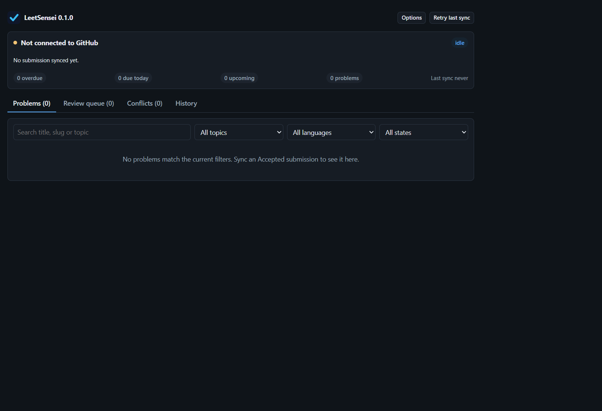
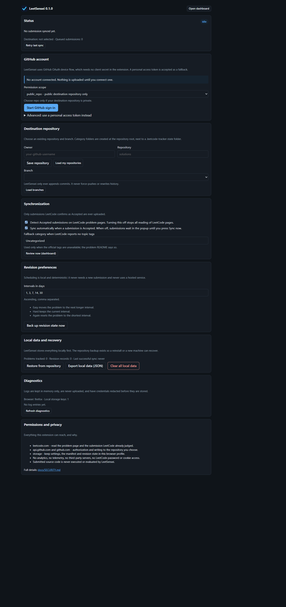
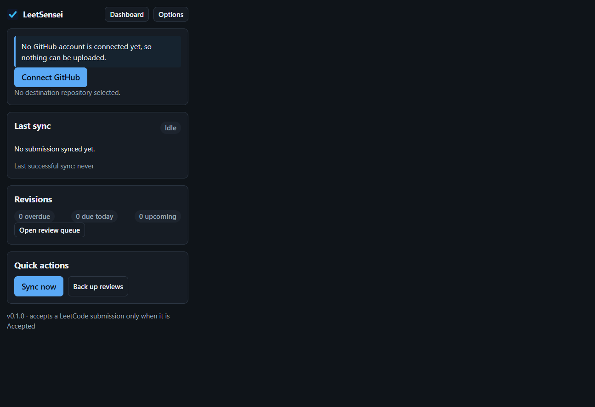

# LeetSensei

An open-source browser extension that automatically syncs **Accepted** LeetCode submissions to GitHub, organizes them by official topic tag, and tracks revisions.

Built with zero runtime dependencies, no telemetry, and no required paid services.

> **Status: early MVP, working and tested, not yet published to any browser store.**
> The sync engine, revision tracker, conflict handling and GitHub integration are
> implemented and covered by 440 automated tests. See
> [Feature status](#feature-status) for exactly what is verified and what is not.

## What it does

1. You solve a problem on LeetCode and it is judged **Accepted**.
2. LeetSensei reads the submission (source code, language, problem id, title, difficulty and official topic tags).
3. It writes the solution into your own GitHub repository, once per applicable topic:

```text
your-solutions-repo/
├── Array/
│   └── 0217-contains-duplicate/
│       ├── README.md
│       └── solution.py
├── Hash-Table/
│   └── 0217-contains-duplicate/
│       ├── README.md
│       └── solution.py
└── .leetcode-tracker/
    ├── manifest.json
    └── revisions.json
```

4. A revision queue then tells you when to revisit each problem, using a deterministic
   interval ladder and your own Easy / Hard / Again self-assessment.

Only Accepted submissions are ever uploaded. Wrong Answer, Runtime Error, Time Limit
Exceeded, Compilation Error and Pending results are ignored by design, and the check
happens twice: once against the page verdict and again against the submission record.

## Feature status

| Area                                     | Status                   | Notes                                                                                                                                                    |
| ---------------------------------------- | ------------------------ | -------------------------------------------------------------------------------------------------------------------------------------------------------- |
| Accepted-only gate                       | **Implemented, tested**  | Single validator; every non-Accepted status has a test                                                                                                   |
| Language coverage                        | **Implemented, tested**  | ~40 LeetCode languages; unknown languages are reported, never guessed                                                                                    |
| Topic-tag → folder mapping               | **Implemented, tested**  | `Hash Table` → `Hash-Table`, Unicode-safe, collision-safe, reserved-name-safe                                                                            |
| Problem README                           | **Implemented, tested**  | Pre-filled template; your approach, complexity and notes survive every sync                                                                              |
| Multi-language solutions                 | **Implemented, tested**  | One file per language, accumulated across submissions                                                                                                    |
| Manifest + hashing                       | **Implemented, tested**  | Versioned schema with migration, per-file sha256 and Git blob ids                                                                                        |
| Conflict protection                      | **Implemented, tested**  | Replace / Save version / Cancel; compare-by-blob-id before writing                                                                                       |
| Grouped commits                          | **Implemented, tested**  | One submission → one commit via the Git data API; never `force`                                                                                          |
| Idempotent retries                       | **Implemented, tested**  | Content-addressed blobs; a repeated event creates no duplicate files                                                                                     |
| Rate limits / offline / expiry           | **Implemented, tested**  | Bounded backoff, `retry-after`, retryable vs terminal error taxonomy                                                                                     |
| Revision scheduler                       | **Implemented, tested**  | Ladder 1/3/7/14/30 days; Easy advances, Hard holds, Again resets                                                                                         |
| Revision backup + restore                | **Implemented, tested**  | Backed up to `.leetcode-tracker/revisions.json`, restorable on a new device                                                                              |
| First-run onboarding                     | **Verified in Chromium** | Three steps (connect → choose repository → ready), auto-polling sign-in, no scope question, no token field; a release build renders zero password inputs |
| Popup / dashboard / options              | **Verified in Chromium** | All three pages load, render and talk to the background worker with no console errors                                                                    |
| LeetCode GraphQL queries                 | **Live-verified**        | Confirmed against `leetcode.com/graphql`, from a plain client and from a real browser page                                                               |
| LeetCode submit button + page structure  | **Live-verified**        | The real control is `data-e2e-locator="console-submit-button"`, and no verdict node exists before a submission                                           |
| LeetCode verdict node after a submission | **Not live-verified**    | It only exists after submitting, which needs an account. Mitigated by scanning every `data-e2e-locator` node                                             |
| End-to-end sync in a browser             | **Not yet performed**    | Needs a GitHub account and an accepted submission; the procedure is in [docs/TESTING.md](docs/TESTING.md)                                                |
| Browser-store publication                | **Chrome: prepared**     | 1.0.0 build and listing copy ready; needs the maintainer's accounts, screenshots and review                                                              |

## Screenshots

Captured from the built extension loaded unpacked in a real Chromium browser
(Chrome for Testing, dark colour scheme), on a fresh install with nothing connected yet — so
these show the genuine empty states, not mock-ups:

| Dashboard                                                 | Options                                               |
| --------------------------------------------------------- | ----------------------------------------------------- |
|  |  |



The colour scheme follows your system preference; these were captured with dark mode active.
Populated views (problems, review queue, conflicts) are not shown yet because that needs a
connected GitHub account and a synced submission.

## Requirements

- Chrome 111+ / Brave (any recent version) / Firefox 115+
- Node.js 20.11+ and npm (development only)
- A GitHub account

## Installation

> **Chrome Web Store:** 1.0.0 is being prepared for submission. This section will link to the
> listing once it is approved. Until then, install from source below — it is the same build
> reviewers will see.

### From source (developers)

```bash
git clone https://github.com/ADxSD-143/LeetSensei.git
cd LeetSensei
npm ci --include=dev
npm run build          # or: npm run build:chrome / npm run build:firefox
```

This produces `dist/chrome/` and `dist/firefox/`.

### Chrome / Brave / Edge (developer install)

1. Open `chrome://extensions` (or `brave://extensions`).
2. Enable **Developer mode**.
3. Choose **Load unpacked** and select `dist/chrome`.
4. Pin LeetSensei, then click **Connect GitHub** and follow the three-step setup.

### Firefox (developer install)

1. Open `about:debugging#/runtime/this-firefox`.
2. Choose **Load Temporary Add-on…** and select `dist/firefox/manifest.json`.
3. Temporary add-ons are removed when Firefox restarts; a permanent install needs a
   signed package from addons.mozilla.org (see [docs/INSTALLATION.md](docs/INSTALLATION.md)).

## First-time setup

Three steps, and no token to create:

1. **Connect GitHub.** Click the button, approve the one-time code on the GitHub page that
   opens. LeetSensei detects the approval by itself; there is no password to type and no
   token to copy.
2. **Choose where solutions go.** Your repositories load automatically — pick one, then pick
   a branch (the default branch is preselected). LeetSensei verifies the repository is
   writable and the branch exists before saying it is ready.
3. **Ready.** Solve problems on LeetCode; Accepted solutions are saved automatically.

**Using a private repository?** LeetSensei asks for public-repository access by default. If
your destination is private, click **Allow private repositories** and approve once more —
nothing wider is requested unless you ask for it.

LeetSensei only ever appends commits; it never force-pushes and never deletes files.

<details>
<summary>Development note: building with your own OAuth client id</summary>

A store build ships a public OAuth `client_id` baked in at build time (never a client secret).
To produce that build you need your own registered GitHub OAuth App:

```bash
# Windows (cmd)
set LEETSENSEI_GITHUB_CLIENT_ID=Iv1.xxxxxxxxxxxx
npm run build

# PowerShell
$env:LEETSENSEI_GITHUB_CLIENT_ID = "Iv1.xxxxxxxxxxxx"
npm run build

# macOS / Linux
LEETSENSEI_GITHUB_CLIENT_ID=Iv1.xxxxxxxxxxxx npm run build
```

Enable **Device flow** on the OAuth App. A release build (`npm run release`) refuses to run
without a valid client id, and disables the personal-access-token fallback that development
builds offer. See [docs/RELEASE.md](docs/RELEASE.md).

</details>

## Development

```bash
npm run verify        # format check + lint + typecheck + tests + build
npm run format        # prettier --write
npm run lint          # eslint
npm run typecheck     # tsc --noEmit
npm test              # vitest run (440 tests)
npm run build         # bundle for Chrome and Firefox
npm run package       # build and produce dist/<browser>.zip
npm run icons         # regenerate icons/*.png
```

`npm run build -- --watch` rebuilds on change.

### Architecture summary

Strict TypeScript, bundled with **esbuild**, tested with **Vitest**, linted with
**ESLint** and formatted with **Prettier**. There are **no runtime dependencies** —
everything the extension ships is code in this repository.

```text
LeetCode page
  → adapters/leetcode      detection + GraphQL extraction (the only LeetCode-aware code)
  → core/normalize         Accepted-only gate, hashing, canonical record
  → core/plan              tags → folders, README render, deterministic file plan
  → core/conflicts         three-way comparison (planned / known / remote)
  → core/resolve           Replace / Save version / Cancel
  → github/*               device-flow auth, REST client, grouped commit, verification
  → storage/*              local state (primary) + .leetcode-tracker backups
  → background/coordinator the only module that mutates state; serialises every operation
  → popup / dashboard / options   UI, always over the typed message protocol
```

The two-phase planner (`planContentFiles` → `finalizePlan`) exists so conflicts can be
resolved _before_ the manifest that describes the final file set is rendered.

Full details: [docs/ARCHITECTURE.md](docs/ARCHITECTURE.md),
[docs/TDD.md](docs/TDD.md), [docs/REPOSITORY_LAYOUT.md](docs/REPOSITORY_LAYOUT.md).

### Why esbuild and not a framework

The extension needs three HTML pages, one content script and one service worker, with a
manifest that differs by browser. That is a small, well-understood bundling problem.
esbuild solves it with one dependency, emits plain classic scripts (avoiding module/CSP
awkwardness across Chrome MV3 and Firefox MV3), and keeps `npm run build` under a second.
No framework earns its dependency budget here; the DOM helpers in `src/ui` are ~150 lines.

## Testing

```bash
npm test
```

- **440 tests** across 29 files: unit tests for all core logic, plus integration tests for
  the GitHub layers driven by an in-memory GitHub that reproduces content-addressed blobs,
  fast-forward-only ref updates and concurrent pushes.
- Covered explicitly: Accepted vs non-Accepted, malformed metadata, hashing determinism,
  language mapping, tag/path collisions, manifest validation and migration, conflict
  classification, versioned filenames, duplicate events, idempotent retries, remote
  reconciliation, revision transitions and date boundaries, backup/restore, malicious
  paths, token expiry, rate limits, grouped commits, partial writes and disconnect.
- **No automated test ever writes to a real solutions repository.** Remote behaviour is
  simulated and the network is never used by the test suite.

See [docs/TESTING.md](docs/TESTING.md) for the full matrix, including what is
unit-tested, mocked, locally verified and live-verified.

## Privacy and security

- **No telemetry, no analytics, no third-party servers.** The only hosts contacted are
  `leetcode.com`, `github.com` and `api.github.com`.
- **No LeetCode password or cookie access.** LeetCode requests are same-origin and rely on
  the page's own session; the CSRF token, when needed, comes from a `<meta>` tag.
- **Your GitHub token** is stored in the extension's own isolated storage and sent only to
  `api.github.com`. It is never written to the repository, never logged (logs redact
  anything token-shaped) and never included in exports.
- **Minimal permissions**: `storage`, `alarms`, and host access to LeetCode plus GitHub
  only. No `<all_urls>`, no broad content scripts.
- **Submitted source code is never executed** and is treated as untrusted text.
- **Nothing is overwritten silently.** A file that changed since the last sync raises a
  conflict you must resolve.

Full details and how to report a vulnerability: [docs/SECURITY.md](docs/SECURITY.md). The
user-facing policy is [PRIVACY.md](PRIVACY.md).

## Limitations

- Detection depends on LeetCode's page markup for the _trigger_ (a verdict node or a submit
  click). Everything after that trigger uses LeetCode's GraphQL API. If LeetCode renames
  those elements, syncing stops with a clear error rather than corrupting data.
- A repository with more than 100,000 files may be truncated by GitHub's tree API; this is
  detected, surfaced, and makes conflict detection more conservative.
- Branches are append-only from LeetSensei's side; it will not create a branch for you.
- The revision queue is stored locally first; the repository backup is written after each
  change but needs a connection (changes are never lost — they are retried).

Practical fixes: [docs/TROUBLESHOOTING.md](docs/TROUBLESHOOTING.md).

## Roadmap

See [ROADMAP.md](ROADMAP.md).

## Contributing

See [CONTRIBUTING.md](CONTRIBUTING.md).

## License

MIT. See [LICENSE](LICENSE).

Problem statements, test data and metadata remain the property of LeetCode. LeetSensei
stores only the source code you submitted and the metadata needed to organise it.
